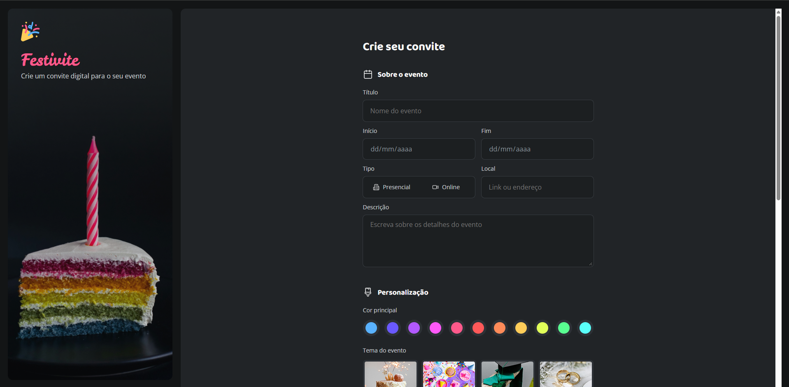
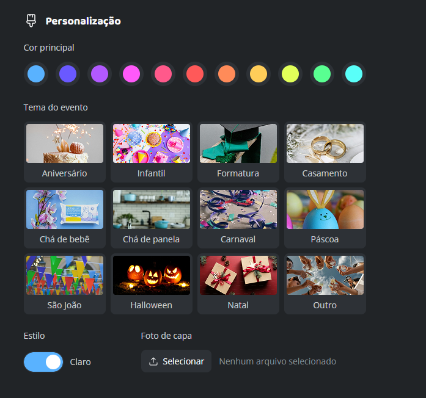

# Festivite

Interface de um formulário para criação de convites digitais.

O projeto foi desenvolvido como uma aplicação simples de estudo, com foco na prática de HTML semântico, CSS, organização de formulários e criação de uma interface visual para eventos.

## Demonstração

[Acessar o projeto no GitHub Pages](https://jpfreitas-dev.github.io/formulario-de-convite/)

### Tela inicial



### Personalização do convite



## Funcionalidades

- Preenchimento dos dados principais do evento.
- Seleção entre evento presencial e online.
- Escolha de cores para o convite.
- Seleção de temas para diferentes tipos de eventos.
- Alternância visual entre os estilos claro e escuro.
- Seleção de imagem de capa.
- Preenchimento dos dados de contato.
- Opções de aceite de termos e recebimento de comunicações.
- Validação nativa dos campos obrigatórios.

## Tecnologias utilizadas

- HTML5
- CSS3
- CSS Grid
- Flexbox
- CSS Nesting
- Variáveis CSS
- SVG
- Google Fonts

## Como executar

O projeto é uma aplicação estática e não possui dependências para instalar.

1. Clone o repositório:

```bash
git clone https://github.com/jpfreitas-dev/formulario-de-convite.git
```

2. Acesse a pasta do projeto:

```bash
cd formulario-de-convite
```

3. Abra o arquivo `index.html` no navegador.

Durante o desenvolvimento, também é possível utilizar a extensão **Live Server** no Visual Studio Code.

## Estrutura do projeto

```text
.
├── assets/
│   ├── ícones e imagens do formulário
│   ├── themes/
│   ├── screenshot-desktop.png
│   └── screenshot-personalizacao.png
├── styles/
│   ├── fields/
│   ├── forms.css
│   ├── global.css
│   ├── index.css
│   └── layout.css
└── index.html
```

## Status do projeto

Concluído como projeto de estudo de HTML e CSS.

## Limitações atuais

- O formulário não possui backend para salvar ou gerar convites reais.
- O botão “Gerar convite” ainda não possui lógica de geração.
- O upload da imagem é apenas visual e não processa o arquivo.
- O modo claro/escuro altera somente o estado visual do controle.
- Os links de termos e política de privacidade ainda são demonstrativos.
- A interface foi desenvolvida inicialmente para telas grandes e ainda não possui responsividade completa.

## Aprendizados

O projeto permitiu praticar estrutura semântica de formulários, organização de CSS em módulos, criação de layouts com Grid e Flexbox, uso de variáveis CSS, estilização de estados de interação e organização de arquivos estáticos.
